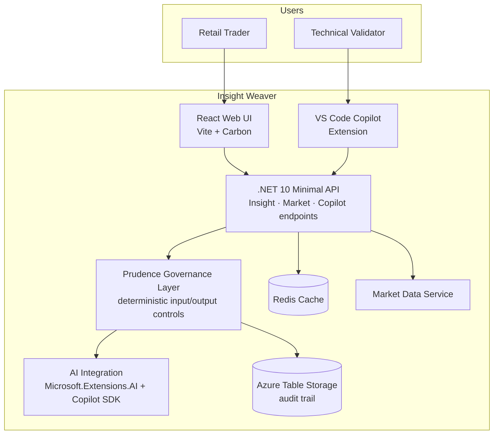

# Insight Weaver

**Exploring trustworthy AI engineering in financial research**

Insight Weaver is an open-source engineering project exploring how AI-assisted equity research can be designed with explicit governance, auditable decisions, and clear architectural boundaries.

Built around Indian equity markets (NSE/BSE), it combines AI-powered research workflows with distributed application patterns using .NET Aspire, .NET 10, React, and GitHub Copilot SDK.

**Methodology:** [rajc.work](https://rajc.work) · **License:** [MIT](LICENSE)

---

## The Engineering Challenge

Integrating an LLM into an application is relatively straightforward. Making its behavior explainable, governable, testable, and operationally reliable is a much harder engineering problem.

Insight Weaver explores four questions:

1. How should AI capabilities integrate into conventional application architecture?
2. Where should deterministic controls govern probabilistic AI behavior?
3. How can we make AI-assisted workflows traceable and auditable?
4. How can we design for operational reliability without introducing unnecessary complexity?

## Architectural Approach

The system separates the user experience, application APIs, AI integration, governance controls, and supporting infrastructure:



*Conceptual diagram based on the documented components — see [architecture diagrams](reference-docs/04-architecture-diagrams.md) for verified views.*

Core technologies: .NET Aspire, .NET 10 Minimal APIs, React, TypeScript, GitHub Copilot SDK, Redis, and Azure Table Storage.

### Engineering Principles

- **Governance by design:** Enforce policy at explicit application boundaries.
- **Separation of concerns:** Keep AI integration independent from core business controls.
- **Auditability:** Preserve evidence needed to understand system behavior.
- **Local-first development:** Enable repeatable experimentation with local infrastructure.
- **Evolutionary architecture:** Record trade-offs and evolve the design based on evidence.

## Scope

This repository is an engineering exploration and reference implementation, not a financial advisory service or a claim of production certification.

The goal is to make the architectural reasoning, implementation choices, and operational trade-offs visible to other engineers.

*Engineering philosophy: Build to Understand.*

## Explore the Project

- [Architecture and design decisions](reference-docs/03-architecture-decision-records.md) — 11 ADRs with context, rationale, and consequences
- [Architecture diagrams](reference-docs/04-architecture-diagrams.md) — logical, deployment, data flow, and compliance views
- [Governance and compliance approach](reference-docs/07-compliance-governance.md) — Prudence middleware, audit trail, responsible AI
- [High-level](reference-docs/01-high-level-design.md) and [low-level design](reference-docs/02-low-level-design.md)
- [API reference](reference-docs/05-api-reference.md)
- Quickstart, endpoints, and tests — below

## Roadmap

| Status | Capability |
|--------|------------|
| Implemented | Static NSE/BSE market data behind a service abstraction, AI insights/briefs/chat, Prudence governance middleware, audit trail to Azure Tables, Redis response caching, dual interface (web + VS Code Copilot extension) |
| Experimental | Copilot extension natural-language skill routing, GitHub Models as AI provider (free tier) |
| Proposed | Live market data provider, streaming AI responses, Azure OpenAI as production provider |

## Known Limitations

- Market data is static seeded data — no intraday updates; live provider required before any production use ([ADR-010](reference-docs/03-architecture-decision-records.md))
- Streaming AI responses are not implemented ([ADR-003](reference-docs/03-architecture-decision-records.md))
- Whole-word policy matching can produce false positives ([ADR-004](reference-docs/03-architecture-decision-records.md))
- The audit table grows continuously; retention/pruning is manual ([ADR-007](reference-docs/03-architecture-decision-records.md))
- The Copilot Extension requires additional setup (GitHub App registration, CLI authentication) and skill routing may misclassify ambiguous prompts ([ADR-009](reference-docs/03-architecture-decision-records.md))

---

## Architecture

```
.NET Aspire AppHost (Orchestrator)
+------------------+    +-------------------------------+
| React Frontend   |--->| .NET 10 Minimal API           |
| (Vite + Carbon)  |    | - Insight Endpoints           |
| Port 8080        |    | - Market Data Endpoints       |
+------------------+    | - Copilot Extension Webhook   |
                        | - Prudence Compliance Layer   |
                        +-------------------------------+
                             |          |          |
                        +----+    +-----+    +-----+
                        |         |          |
                   GitHub      Azurite     Redis
                   Copilot SDK (Storage)   (Cache)
                   (AI)        (Emulator)  (Emulator)
```

| Layer | Technology |
|-------|------------|
| Orchestration | .NET Aspire 10 |
| Backend | .NET 10 Minimal API + Microsoft.Extensions.AI |
| Frontend | React 18 + TypeScript + Vite |
| AI | GitHub Copilot SDK |
| Cache | Redis via Aspire |
| Storage | Azure Table Storage (Azurite emulator in dev) |
| Governance | Prudence Middleware (SEBI-aware governance controls) |

---

## Quickstart

**Prerequisites:** .NET 10 SDK, Docker Desktop, Node.js 18+, GitHub Copilot CLI with `GITHUB_TOKEN`

```bash
dotnet run --project api/src/IdeaFactory.AppHost
```

Starts the API (typically `http://localhost:5074`), UI (`http://localhost:8080`), Redis, and Azurite via Aspire. Exact URLs are shown in the Aspire dashboard.

```bash
curl http://localhost:5074/health
```

---

## API Overview

| Area | Endpoints |
|------|-----------|
| Market | `/api/market/indices`, `/movers`, `/stock/{ticker}`, `/news`, `/search` |
| AI Insights | `/api/insight/today`, `/brief`, `/explain`, `/chat` |
| Copilot | `/copilot/resolve`, `/copilot/skills` |
| Governance | `/api/governance/report`, `/api/governance/audits` |

---

## Governance

- All AI responses include mandatory SEBI disclaimer
- Buy/sell/hold recommendations blocked (HTTP 422)
- Every AI request/response audited to Azure Table Storage
- Rate limiting on AI endpoints

See the [Compliance and Governance Guide](reference-docs/07-compliance-governance.md) for the full control set. These are SEBI-aware governance controls implemented in good faith — no formal regulatory assessment has been performed.

---

## Project Structure

```
insight-weaver/
  api/src/          # AppHost, API, ServiceDefaults
  api/tests/         # Integration tests
  ui/src/            # React components, hooks, services
  reference-docs/   # Architecture, ADRs, API reference
```

---

## Documentation

- [Reference docs](reference-docs/) — HLD, LLD, ADRs, diagrams, compliance guide

---

## Tests

```bash
cd api && dotnet test
cd ui && npm test
```

---

Fork it. Adapt it. Build your own Idea Factory.
