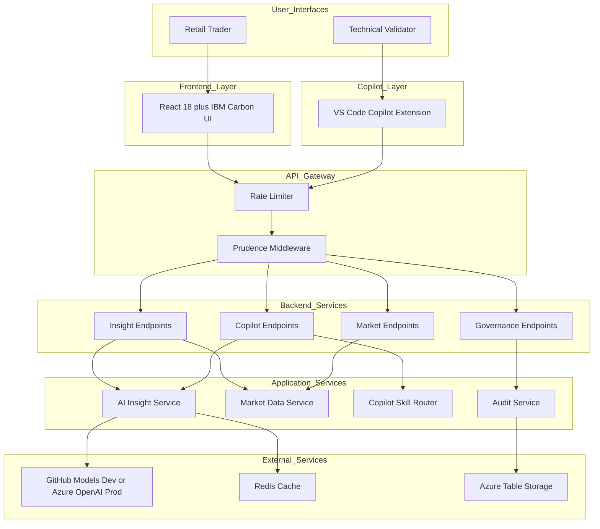
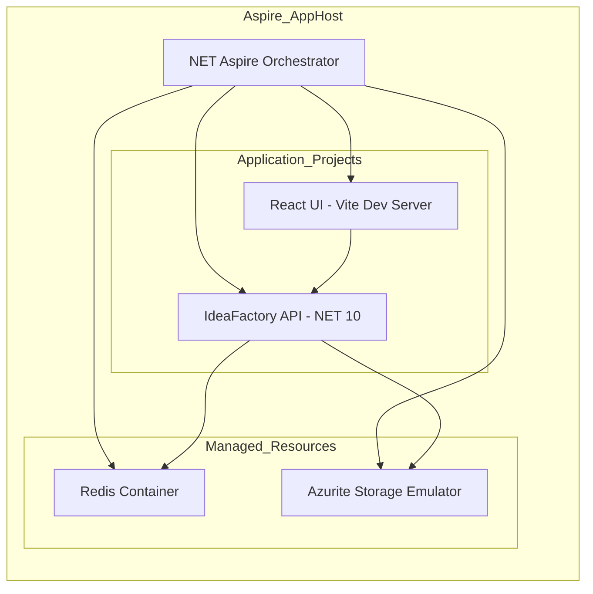
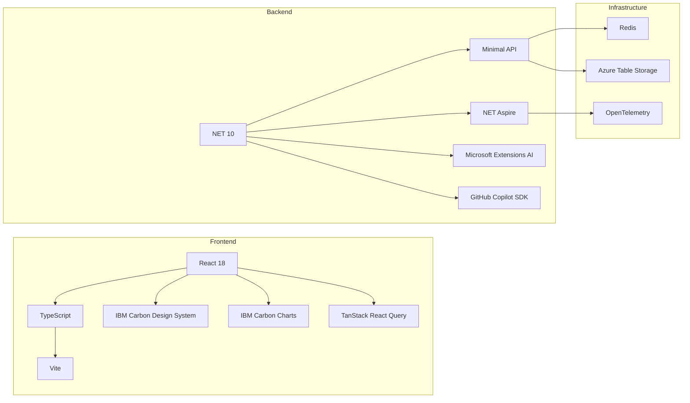
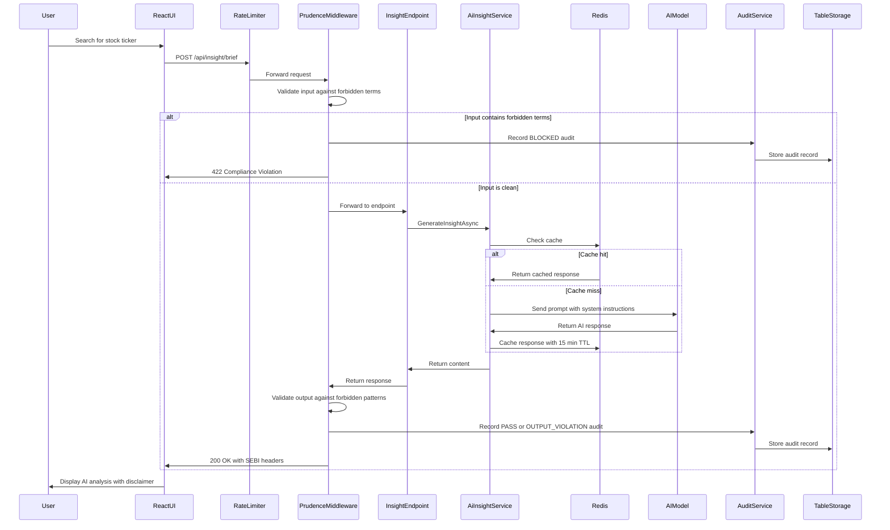

# High-Level Design (HLD): The Idea Factory

**Project:** Insight Weaver (The Idea Factory)
**Version:** 1.0
**Date:** 2026-02-15
**Architect:** Raj Champaneriya

---

## 1. Executive Summary

The Idea Factory is an AI-powered insight platform for Indian equities (NSE/BSE). It aggregates publicly available market data and generates AI-driven analysis for retail traders, reducing manual research time by up to 90%. The platform is designed as an **Information Tool**, not an Advisory Engine, ensuring compliance with SEBI (Securities and Exchange Board of India) regulations by never generating buy/sell/hold recommendations.

The system serves two personas through two interfaces:
- **Retail Trader** -- via a React web application with IBM Carbon Design System
- **Technical Validator** -- via a VS Code GitHub Copilot Extension

Both interfaces share the same backend API and compliance pipeline, ensuring uniform governance regardless of access point.

---

## 2. Business Context

### 2.1 Problem Statement

| Stakeholder | Problem |
|---|---|
| Enterprise | Innovation in financial analytics stalls due to "budget friction" -- architects cannot test AI hypotheses without a full business case |
| Retail Investor | Struggles to interpret large volumes of fundamentals, price data, and news, leading to emotion-driven decisions |

### 2.2 Solution Approach

The Idea Factory is a **sanctioned local experiment** that proves an AI insight layer can be built rapidly using existing Azure credits and sandbox environments. It generates **evidence** (working prototypes with measurable outcomes) rather than theoretical business cases.

### 2.3 Key Business Goals

| Goal | Target | Measurement |
|---|---|---|
| Innovation Velocity | Idea to prototype in 2 weeks | Sprint burndown against delivery plan |
| Research Time Reduction | 90% reduction per stock idea | Comparative user task timing |
| Governance Compliance | Zero policy violations | Automated audit trail analysis |
| API Latency | P95 under 3 seconds | OpenTelemetry percentile metrics |

---

## 3. System Overview

The platform is built as a distributed application orchestrated by .NET Aspire. It consists of a React single-page application (frontend), a .NET 10 Minimal API (backend), and supporting infrastructure services (Redis cache, Azure Table Storage).

### 3.1 Logical Architecture

### 3.2 Deployment Architecture

### 3.3 System Boundaries

| Boundary | Inside | Outside |
|---|---|---|
| Data Scope | NSE/BSE cash equities only | Derivatives, international markets |
| AI Capability | Informational analysis only | Investment recommendations |
| Currency | INR only | Foreign currencies |
| Data Sources | Publicly available data | Proprietary or paid feeds |
| Phase 1 Scope | Core insight generation | Portfolio tracking, trade execution |

---

## 4. Component Summary

### 4.1 Frontend (React 18 + IBM Carbon)

The user-facing web application provides five primary views:

| Page | Purpose | Key Components |
|---|---|---|
| Dashboard | Market overview with indices, unusual movers, and news | MarketOverview, UnusualMovers, NewsFeed, QuickSearch |
| Stock Explorer | Deep-dive into individual stock data with AI briefs | Price charts, financials table, AI Brief panel |
| Watchlist | User-curated stock groups with live price data | Grouped tables and card views |
| AI Briefcase | AI-generated briefs for watchlist stocks | Peter Lynch-style analysis cards |
| Settings | Configuration and compliance information | SEBI disclaimers, responsible AI principles |

An AI Assistant panel (slide-out chat) is accessible from any page via the header.

### 4.2 Backend API (.NET 10 Minimal API)

The backend exposes four endpoint groups:

| Group | Base Path | Purpose |
|---|---|---|
| Insight | /api/insight | AI-generated stock analysis (today view, brief, explain, chat) |
| Market | /api/market | Market data (indices, movers, stock details, news, search) |
| Governance | /api/governance | Compliance audit reports and raw audit records |
| Copilot | /copilot | VS Code Copilot Extension webhook with skill routing |

### 4.3 Middleware Pipeline

Every HTTP request passes through:

1. **CORS** -- Allows frontend origins (localhost:8080, 5173, 3000)
2. **Rate Limiter** -- 10 req/min for AI endpoints, 120 req/min global per IP
3. **Prudence Middleware** -- Compliance validation for AI-related paths

### 4.4 Infrastructure Services

| Service | Purpose | Provider |
|---|---|---|
| Redis | Response caching with 15-minute TTL | Aspire-managed container (dev), Azure Cache (prod) |
| Azure Table Storage | Compliance audit trail persistence | Azurite emulator (dev), Azure Storage (prod) |
| GitHub Models | AI model inference | GitHub Copilot SDK (dev) |
| Azure OpenAI | AI model inference | Azure OpenAI Service (prod) |

---

## 5. Key Design Principles

### 5.1 Governance First

The Prudence compliance layer was built **before** any AI endpoint. Every AI interaction is:
- Validated for forbidden terms (input compliance)
- Checked for prohibited response patterns (output compliance)
- Logged with full audit trail (prompt hash, response hash, policy result, duration)
- Tagged with SEBI disclaimer headers

### 5.2 Provider-Agnostic AI

The `Microsoft.Extensions.AI` abstraction layer (`IChatClient`) allows switching between GitHub Models (development) and Azure OpenAI (production) through configuration only. No business logic changes required.

### 5.3 Dual Interface, Single Pipeline

Both the web UI and the VS Code Copilot Extension share:
- The same AI service layer
- The same compliance middleware
- The same audit trail
- The same rate limiting policies

### 5.4 Cache-Aware Design

AI responses are cached in Redis with a 15-minute TTL. Cache keys incorporate the ticker, insight type, and a hash of the context to ensure cache correctness while reducing AI inference costs.

---

## 6. Technology Stack

---

## 7. Non-Functional Requirements

| Requirement | Target | Implementation |
|---|---|---|
| Latency | P95 under 3 seconds | Redis caching, efficient prompt templates |
| Availability | 99.9% for APIs during pilot | Health checks via Aspire defaults |
| Security | No hardcoded secrets | Azure Managed Identity (prod), environment variables (dev) |
| Compliance | Zero policy violations | Prudence middleware with automated audit trail |
| Cost Control | Hard limits on Azure spending | Aggressive caching, rate limiting |
| Observability | Full distributed tracing | OpenTelemetry via Aspire ServiceDefaults |

---

## 8. Data Flow Summary

---

## 9. Risk Summary

| Risk | Impact | Mitigation |
|---|---|---|
| GitHub Models rate limits | Medium | Aggressive Redis caching, mock responses for UI development |
| SEBI compliance false positives | Low | Tunable forbidden term list with whole-word matching |
| AI hallucination in responses | Medium | Strict system prompts, output validation, mandatory disclaimers |
| Azure cold start latency | Medium | Pre-warm strategy, cache frequent queries |
| .NET 10 preview instability | Low | Pinned SDK version in global.json |
