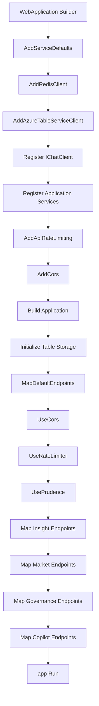
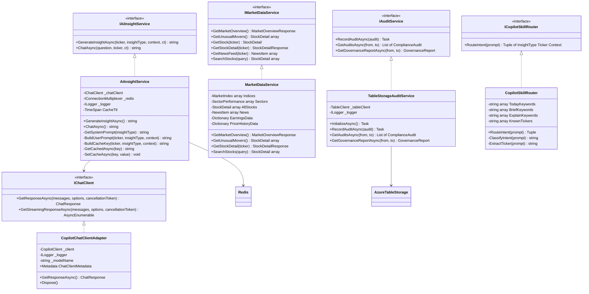
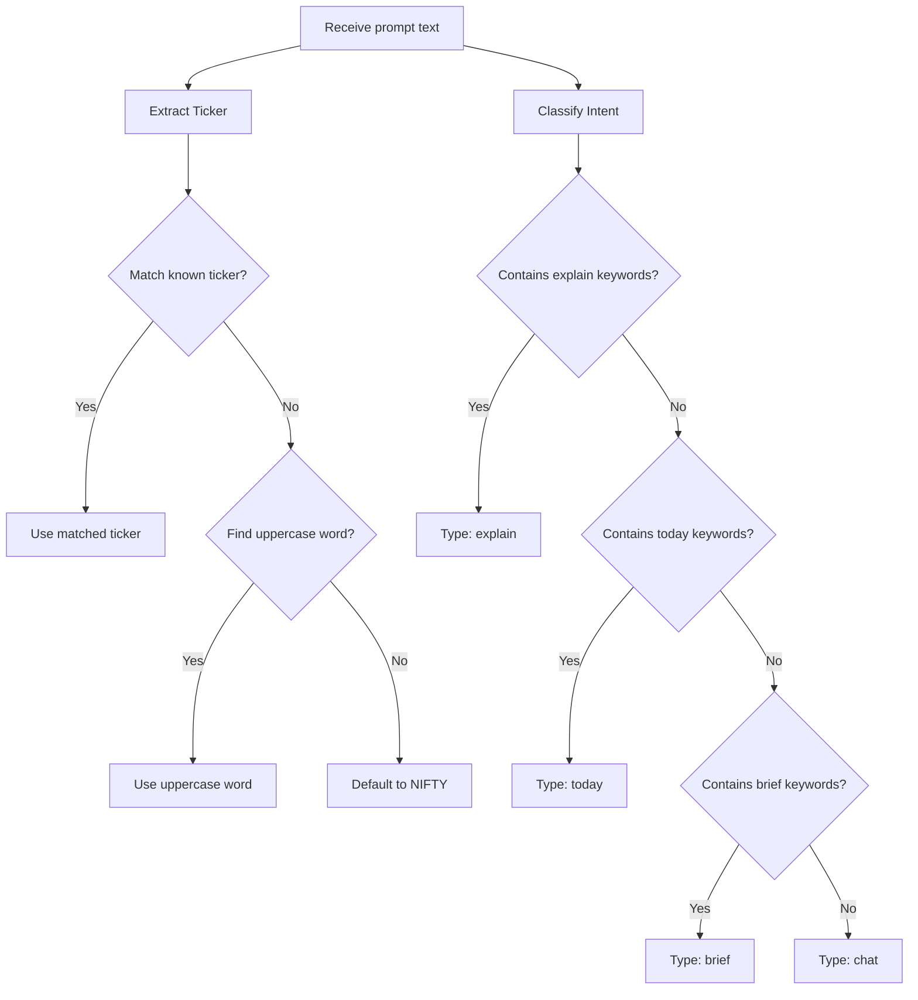
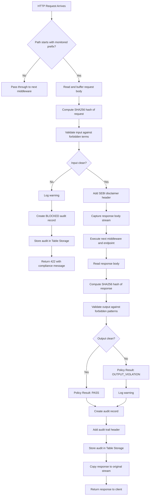
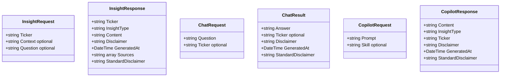
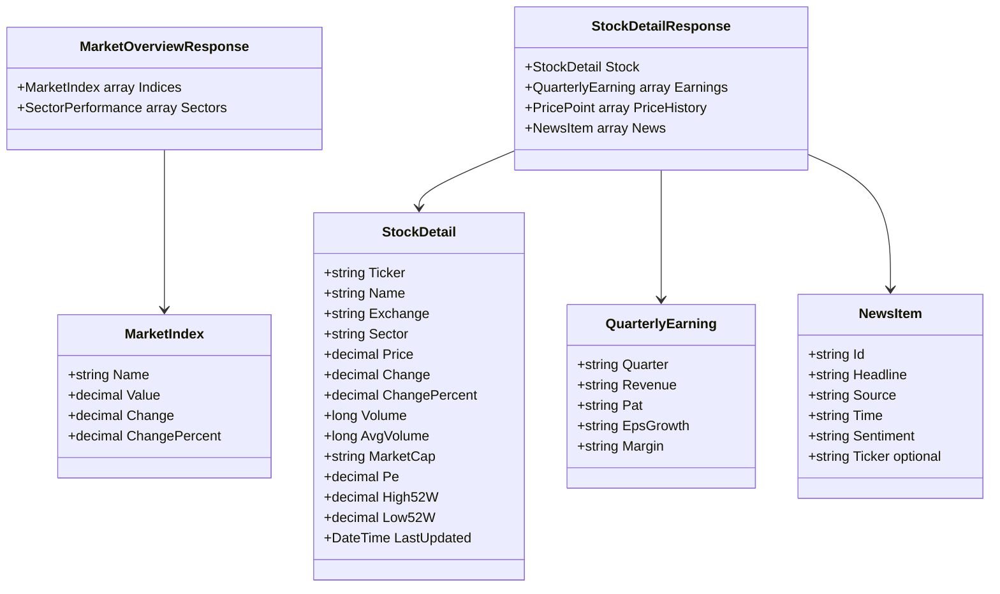
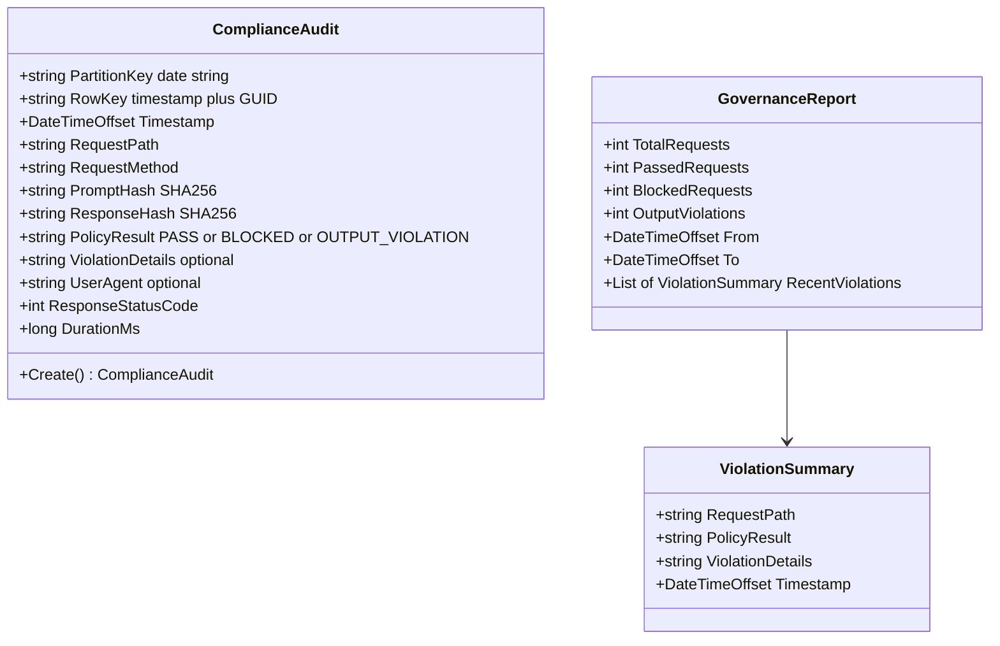
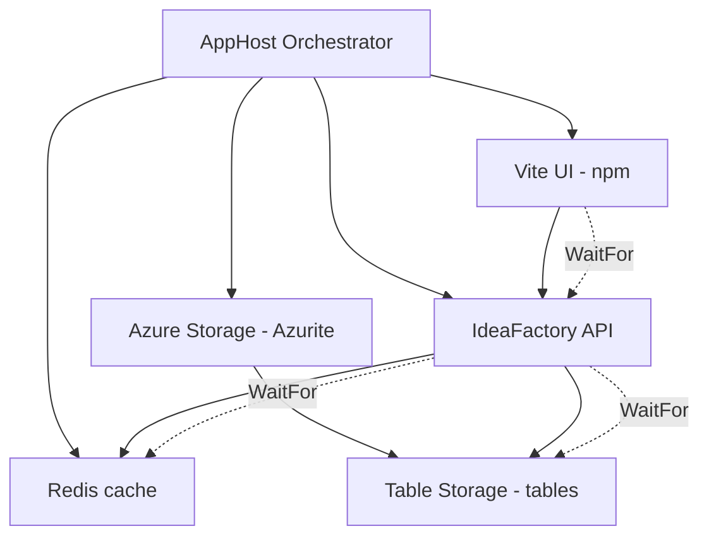

# Low-Level Design (LLD): The Idea Factory -- Pilot #001

**Project:** Insight Weaver (The Idea Factory)
**Version:** 1.0
**Date:** 2026-02-15

---

## 1. Overview

This document provides the detailed low-level design for each component of the Idea Factory platform. It covers class structures, service interactions, data models, middleware pipeline mechanics, and the business logic implemented within each module.

---

## 2. Backend Architecture (.NET 10 Minimal API)

### 2.1 Solution Structure

The backend is organized as a .NET Aspire solution with three projects:

| Project | Purpose |
|---|---|
| IdeaFactory.AppHost | Aspire orchestrator -- defines resources (Redis, Azurite, API, UI) and their dependencies |
| IdeaFactory.ServiceDefaults | Shared extensions for health checks, OpenTelemetry, service discovery, and HTTP resilience |
| IdeaFactory.Api | The main Web API -- endpoints, middleware, services, and models |

### 2.2 Application Startup Pipeline

The API startup in `Program.cs` follows this sequence:

1. **Service Registration** -- Redis, Azure Table Storage, AI client, application services, rate limiting, CORS
2. **Table Initialization** -- Creates the `ComplianceAudit` table in Azure Table Storage if it does not exist
3. **Middleware Pipeline** -- Aspire defaults, CORS, rate limiter, Prudence middleware
4. **Endpoint Mapping** -- Insight, Market, Governance, and Copilot endpoint groups

---

## 3. Service Layer Design

### 3.1 Class Diagram

### 3.2 AI Insight Service

**Purpose:** Generates AI-driven stock analysis by composing prompts with compliance-enforcing system instructions and sending them to the language model.

**Business Logic:**

1. **Cache Check** -- Before calling the AI model, the service constructs a cache key from the ticker, insight type, and context hash. If a cached response exists in Redis (within the 15-minute TTL), it is returned immediately.

2. **Prompt Composition** -- The service selects a system prompt based on the insight type. Each system prompt enforces strict rules:
   - Never provide buy/sell/hold recommendations
   - Never suggest target prices or stop losses
   - All monetary values in INR
   - Reference NSE/BSE exchanges only
   - End every response with a compliance disclaimer

3. **AI Inference** -- The composed messages (system + user) are sent to the language model via `IChatClient.GetResponseAsync()`.

4. **Cache Storage** -- The response is stored in Redis with a 15-minute TTL before being returned to the caller.

**Insight Types and Their System Prompts:**

| Type | Prompt Focus | Output Structure |
|---|---|---|
| today | Daily view with factual observations | Price movement, volume changes, sector trends, corporate actions |
| brief | Peter Lynch-style investment research | 4 sections: The Story, The Numbers, The Moat, The Risks |
| explain | Unusual market movement analysis | Multiple possible explanations, facts vs speculation |
| chat | Free-form Q&A about Indian equities | Factual, well-sourced analysis with citations |

### 3.3 Copilot Chat Client Adapter

**Purpose:** Bridges the `Microsoft.Extensions.AI` IChatClient interface with the GitHub Copilot SDK, enabling AI inference through GitHub's model infrastructure.

**Lifecycle:**

1. On construction, creates a `CopilotClient` instance and reads the model name from configuration (defaults to "gpt-4.1").
2. On each inference request, ensures the Copilot client is connected (starts it if needed).
3. Creates a session with the specified model, appends system messages, and sends user content.
4. Collects streamed response fragments via event handlers until a `SessionIdleEvent` signals completion.
5. Returns the assembled response as a `ChatResponse`.

### 3.4 Copilot Skill Router

**Purpose:** Parses natural language prompts from the Copilot Extension to determine the user's intent (insight type) and the target stock ticker.

**Routing Logic:**

**Keyword Groups:**

| Intent | Keywords |
|---|---|
| today | today, changed, what happened, daily, movement, update |
| brief | brief, analysis, research, overview, tell me about, summary, explore |
| explain | explain, why, unusual, anomaly, spike, crash, drop, surge, reason |
| chat | Default when no other keywords match |

**Known Tickers:** RELIANCE, TCS, HDFCBANK, INFY, TATAMOTORS, ADANIENT, SUNPHARMA, WIPRO, ICICIBANK, HINDUNILVR, BHARTIARTL, KOTAKBANK

### 3.5 Market Data Service

**Purpose:** Provides market data for Indian equities. In the current phase, this service returns seeded static data that mirrors real NSE/BSE market structure. It serves as the data layer that will be replaced with live data feeds in future phases.

**Data Provided:**
- **Market Indices** -- NIFTY 50, SENSEX, NIFTY BANK, NIFTY IT
- **Sector Performance** -- IT, Pharma, FMCG, Auto, Bank, Metal, Energy, Realty
- **Stock Details** -- 12 major NSE-listed stocks with price, volume, market cap, P/E, 52-week range
- **Quarterly Earnings** -- Revenue, PAT, EPS Growth, Margin (seeded for RELIANCE)
- **Price History** -- 12-month price points for charting
- **News Feed** -- 8 news items with sentiment tags and ticker association
- **Search** -- Filters stocks by ticker, name, or sector substring match

### 3.6 Audit Service (Table Storage)

**Purpose:** Records and retrieves compliance audit records for every AI-related request processed by the Prudence middleware.

**Storage Design:**
- **Table:** ComplianceAudit in Azure Table Storage
- **Partition Key:** Date string (yyyy-MM-dd) -- enables efficient date-range queries
- **Row Key:** Timestamp + GUID (HH-mm-ss-fff-GUID) -- ensures uniqueness within a partition

**Governance Report Generation:**

The service aggregates audit records over a date range and produces:
- Total request count
- Passed request count (policy result = PASS)
- Blocked request count (policy result = BLOCKED)
- Output violation count (policy result = OUTPUT_VIOLATION)
- The 20 most recent violations with details

---

## 4. Middleware Pipeline

### 4.1 Prudence Middleware

**Purpose:** The core compliance enforcement layer. It intercepts all AI-related HTTP requests, validates inputs and outputs against SEBI compliance rules, and creates an audit trail for every interaction.

**Monitored Paths:** /api/insight, /api/chat, /copilot

**Processing Flow:**

### 4.2 Compliance Rules

**Input Validation (Forbidden Terms):**

Terms that may constitute investment advice are detected using whole-word matching:

| Category | Terms |
|---|---|
| Action Words | buy, sell, hold |
| Rating Terms | strong buy, strong sell, outperform, underperform, overweight, underweight |
| Target Terms | target price, price target, stop loss |
| Promotional | guaranteed return, sure shot, multibagger, wealth creator |
| Advisory | subscribe, accumulate |

**Output Validation (Forbidden Response Patterns):**

The AI response is scanned for phrases that constitute advice:
- "you should buy", "you should sell"
- "i recommend", "we recommend", "my recommendation"
- "invest in"
- "guaranteed", "risk-free", "sure profit"

**Whole-Word Matching Algorithm:**
The input validator uses a custom word-boundary check: for each forbidden term found in the text, it verifies that the characters immediately before and after the match are not alphanumeric. This prevents false positives (e.g., "household" should not trigger "hold").

### 4.3 Rate Limiting Configuration

Three tiers of rate limiting protect the system:

| Policy | Scope | Limit | Window |
|---|---|---|---|
| AI Endpoint | /api/insight/*, /copilot/* | 10 requests | 1 minute |
| Default | General endpoints | 60 requests | 1 minute |
| Global | Per IP address | 120 requests | 1 minute |

When a rate limit is exceeded, the API returns HTTP 429 with a JSON body containing the `retryAfter` duration.

---

## 5. Data Models

### 5.1 Request/Response DTOs

### 5.2 Market Data Models

### 5.3 Compliance Audit Model

---

## 6. Endpoint Specifications

### 6.1 Insight Endpoints (/api/insight)

| Method | Path | Input | Output | Description |
|---|---|---|---|---|
| POST | /api/insight/today | InsightRequest (ticker, context) | InsightResponse | AI-generated daily view for a stock |
| POST | /api/insight/brief | InsightRequest (ticker) | InsightResponse | Peter Lynch-style 4-section research brief |
| POST | /api/insight/explain | InsightRequest (ticker, context) | InsightResponse | Explanation of unusual price/volume movement |
| POST | /api/insight/chat | ChatRequest (question, ticker) | ChatResult | Free-form conversational Q&A about equities |

### 6.2 Market Endpoints (/api/market)

| Method | Path | Input | Output | Description |
|---|---|---|---|---|
| GET | /api/market/indices | -- | MarketOverviewResponse | Market indices and sector performance |
| GET | /api/market/movers | -- | StockDetail[] | Stocks with unusual price/volume activity |
| GET | /api/market/stock/{ticker} | ticker (path) | StockDetailResponse | Full stock detail with earnings and price history |
| GET | /api/market/news | ticker (query, optional) | NewsItem[] | Market news, optionally filtered by ticker |
| GET | /api/market/search | q (query) | StockDetail[] | Search by ticker, name, or sector |

### 6.3 Governance Endpoints (/api/governance)

| Method | Path | Input | Output | Description |
|---|---|---|---|---|
| GET | /api/governance/report | days (query, default 7) | GovernanceReport | Compliance audit summary for period |
| GET | /api/governance/audits | days (query, default 1) | ComplianceAudit[] | Raw audit records for period |

### 6.4 Copilot Endpoints (/copilot)

| Method | Path | Input | Output | Description |
|---|---|---|---|---|
| POST | /copilot/resolve | CopilotRequest (prompt, skill) | CopilotResponse | Resolve a Copilot Extension query with skill routing |
| GET | /copilot/skills | -- | JSON object | List available skills and supported tickers |

---

## 7. .NET Aspire Orchestration

### 7.1 Resource Wiring

The AppHost defines the following resource graph:

### 7.2 Service Defaults

The ServiceDefaults project provides cross-cutting concerns applied to all Aspire projects:

| Feature | Configuration |
|---|---|
| OpenTelemetry Tracing | ASP.NET Core, HTTP client, runtime instrumentation |
| OpenTelemetry Metrics | ASP.NET Core, HTTP client, runtime metrics |
| OpenTelemetry Logging | Formatted messages with scopes |
| Health Checks | /health (full) and /alive (liveness) endpoints |
| Service Discovery | Automatic service resolution for inter-service calls |
| HTTP Resilience | Standard retry and circuit breaker policies |

---

## 8. Dependency Injection Registry

All services are registered as singletons:

| Interface | Implementation | Lifetime |
|---|---|---|
| IChatClient | CopilotChatClientAdapter | Singleton |
| IAuditService | TableStorageAuditService | Singleton |
| IAiInsightService | AiInsightService | Singleton |
| IMarketDataService | MarketDataService | Singleton |
| ICopilotSkillRouter | CopilotSkillRouter | Singleton |

**Rationale for Singleton:** All services are stateless or use thread-safe clients (Redis multiplexer, Table client). Singleton lifetime avoids unnecessary object allocation and aligns with the Aspire hosting model.
