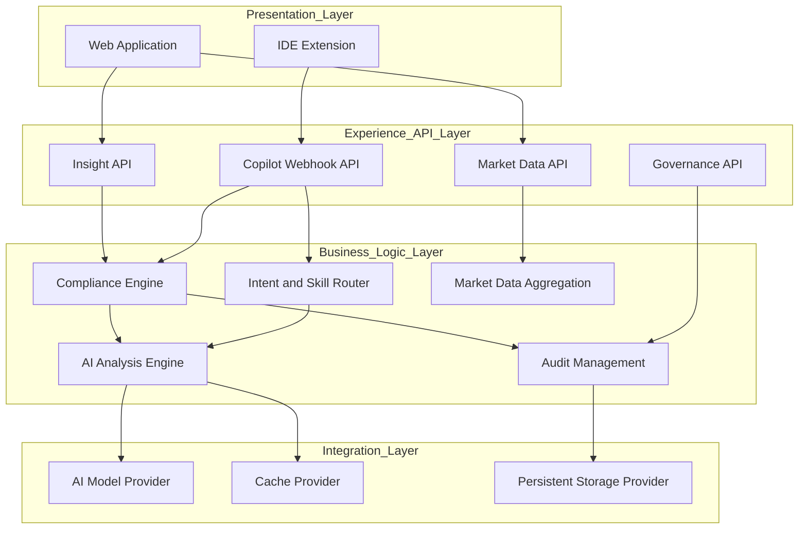
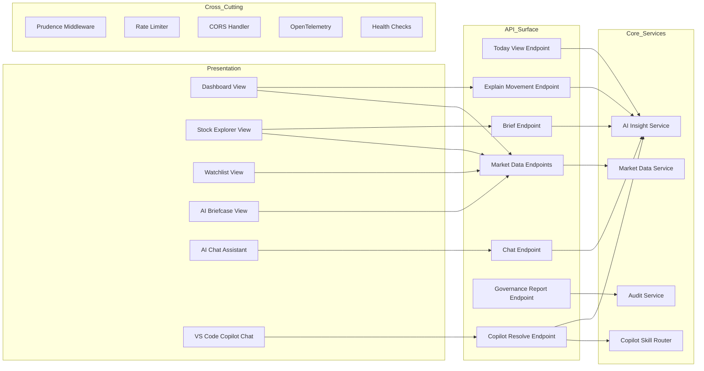
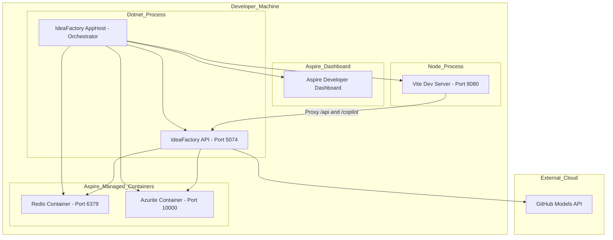
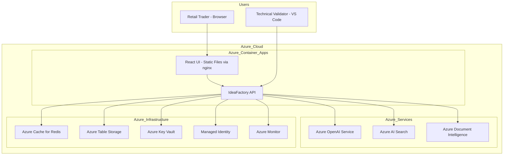
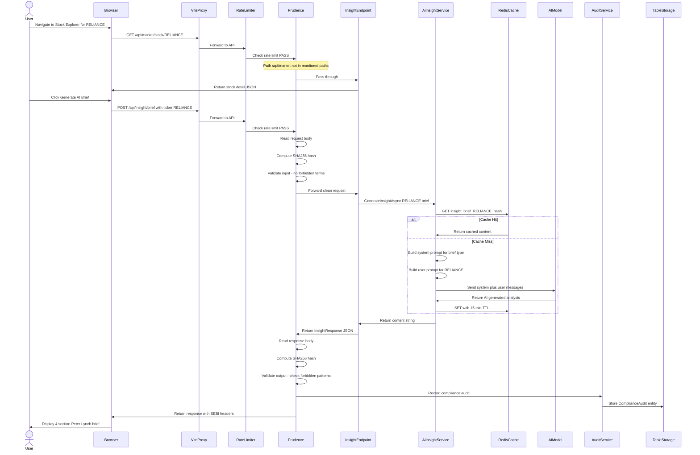
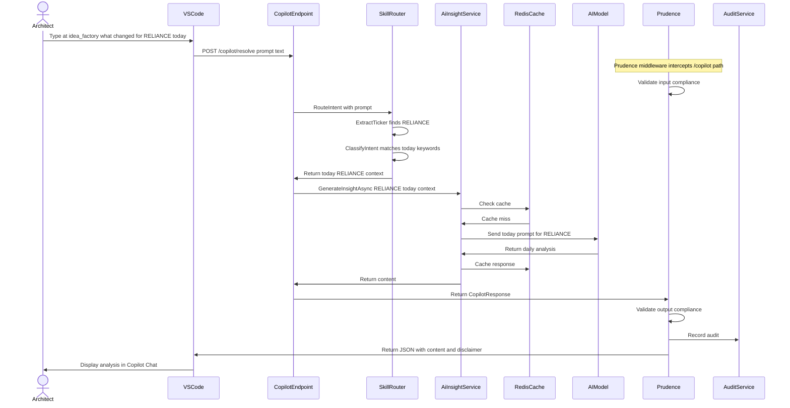
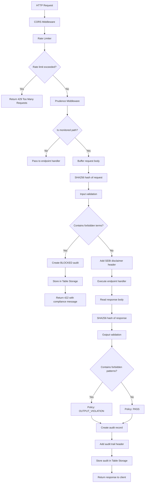
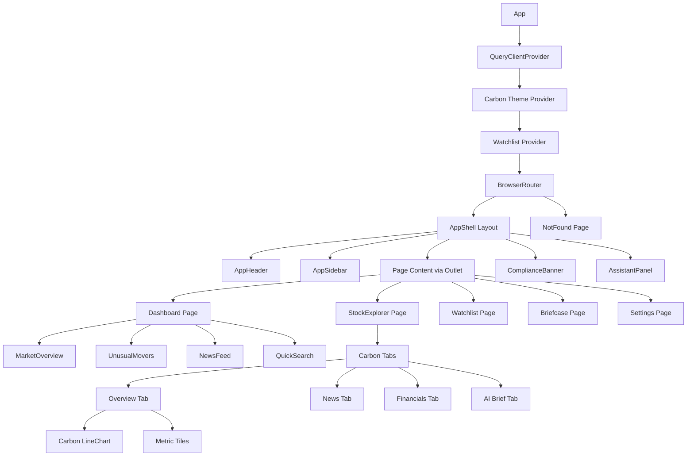
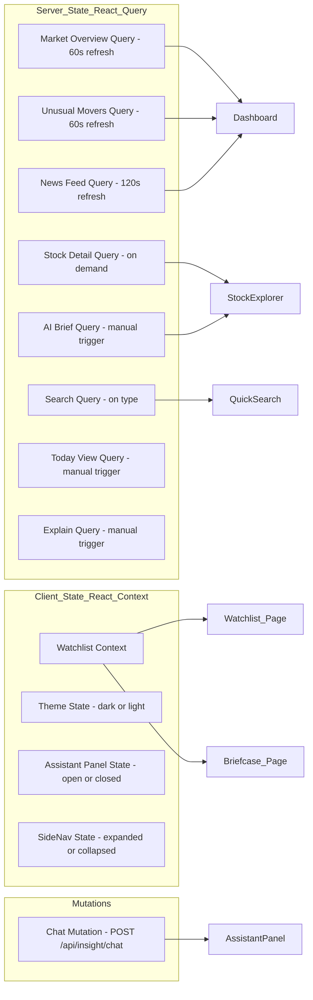
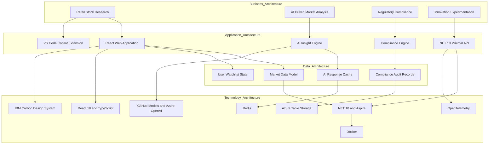

# Architecture Diagrams: The Idea Factory

**Project:** Insight Weaver (The Idea Factory)
**Method:** IBM Architecture Method (Logical, Functional, Operational Views)
**Date:** 2026-02-15

---

## 1. Logical Architecture View

This diagram shows the logical decomposition of the system into functional areas, independent of technology choices.

---

## 2. Functional Component Model

This diagram shows the functional components and their responsibilities within each layer.

---

## 3. Operational Deployment View

This diagram shows how the system components are deployed in the development environment.

---

## 4. Production Deployment View (Target State)

---

## 5. Data Flow: Stock Research Scenario

This sequence diagram shows the end-to-end flow when a user researches a stock.

---

## 6. Data Flow: Copilot Extension Scenario

---

## 7. Component Interaction: Compliance Pipeline

---

## 8. Frontend Component Hierarchy

---

## 9. State Management Architecture

---

## 10. Technology Layer Map (IBM Architecture Method)

