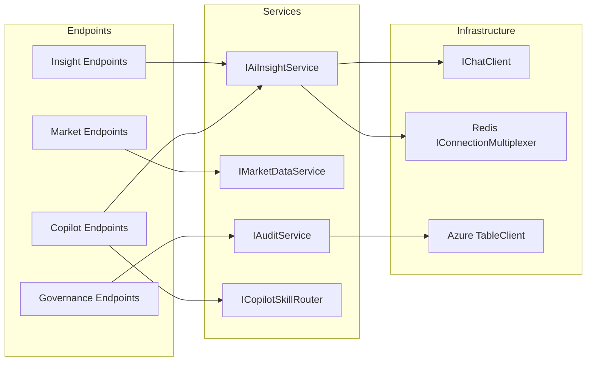

# API Reference and Backend Services Guide

**Project:** Insight Weaver (The Idea Factory)
**Version:** 1.0
**Date:** 2026-02-15

---

## 1. API Overview

The Idea Factory backend exposes a RESTful API organized into four functional groups. All AI-related endpoints are protected by the Prudence compliance middleware and rate limiting.

**Base URL (Development):** `http://localhost:5074`

**Common Response Headers (AI Endpoints):**

| Header | Value | Description |
|---|---|---|
| X-SEBI-Disclaimer | "Not investment advice. For informational purposes only." | Present on all AI endpoint responses |
| X-Compliance-Audit | {partitionKey}/{rowKey} | Reference to the audit record for this request |

---

## 2. Insight Endpoints

These endpoints generate AI-driven stock analysis. All endpoints in this group require a POST request with a JSON body and are rate-limited to 10 requests per minute.

### 2.1 Today's View

**Endpoint:** `POST /api/insight/today`

**Purpose:** Generates a concise daily view of a stock's activity, focusing on price movement, volume changes, sector trends, and notable events.

**Request Body:**
```json
{
  "ticker": "RELIANCE",
  "context": "Optional additional context"
}
```

**Response Body:**
```json
{
  "ticker": "RELIANCE",
  "insightType": "today",
  "content": "AI-generated daily analysis...",
  "disclaimer": "This is AI-generated analysis for informational purposes only...",
  "generatedAt": "2026-02-15T10:30:00Z",
  "sources": ["AI Analysis"]
}
```

**Business Logic Flow:**
1. The Prudence middleware validates the request body for forbidden investment terms
2. The AI Insight Service checks Redis cache for a matching cached response
3. On cache miss, the service builds a system prompt that instructs the AI model to:
   - Focus on factual observations: price, volume, sector context
   - Never provide buy/sell/hold recommendations
   - Use INR currency and reference NSE/BSE exchanges
4. The AI model generates the analysis
5. The response is cached in Redis with a 15-minute TTL
6. The Prudence middleware validates the response for forbidden output patterns
7. A compliance audit record is created and stored

### 2.2 Investment Brief

**Endpoint:** `POST /api/insight/brief`

**Purpose:** Generates a Peter Lynch-style investment research brief with four structured sections.

**Request Body:**
```json
{
  "ticker": "RELIANCE"
}
```

**Response Body:** Same structure as Today's View with `insightType: "brief"`.

**Business Logic:** The system prompt instructs the AI to produce exactly four sections:
1. **The Story** -- What the company does and why it might be interesting to study
2. **The Numbers** -- Key financial metrics (revenue, earnings, margins, debt ratios)
3. **The Moat** -- Competitive advantages or lack thereof
4. **The Risks** -- Key concerns an investor should be aware of

The frontend parses these sections using regex to display them in a structured layout.

### 2.3 Explain Movement

**Endpoint:** `POST /api/insight/explain`

**Purpose:** Explains unusual price or volume movement for a stock, providing possible explanations based on available information.

**Request Body:**
```json
{
  "ticker": "TATAMOTORS",
  "context": "Price changed -4.00%. Volume: 22.1M vs avg 11.4M"
}
```

**Business Logic:** The context field typically contains volume/price change data that helps the AI produce relevant explanations. The system prompt instructs the model to present multiple possible explanations and clearly distinguish between confirmed facts and speculation.

### 2.4 Chat

**Endpoint:** `POST /api/insight/chat`

**Purpose:** Handles free-form conversational questions about Indian equities.

**Request Body:**
```json
{
  "question": "What are the main risks for TCS?",
  "ticker": "TCS"
}
```

**Response Body:**
```json
{
  "answer": "AI-generated answer...",
  "ticker": "TCS",
  "disclaimer": "This is AI-generated analysis for informational purposes only...",
  "generatedAt": "2026-02-15T10:30:00Z"
}
```

**Business Logic:** If a ticker is provided, the model is given additional context about the exchange. Chat responses are not cached (each question may be unique).

---

## 3. Market Data Endpoints

These endpoints serve market data for Indian equities. They are not AI-powered and do not go through the Prudence compliance pipeline (the path /api/market is not in the monitored paths list).

### 3.1 Market Indices

**Endpoint:** `GET /api/market/indices`

**Purpose:** Returns current values of major Indian market indices and sector performance.

**Response Body:**
```json
{
  "indices": [
    { "name": "NIFTY 50", "value": 24856.15, "change": 142.30, "changePercent": 0.58 },
    { "name": "SENSEX", "value": 81903.42, "change": 468.75, "changePercent": 0.58 }
  ],
  "sectors": [
    { "name": "IT", "change": 1.2 },
    { "name": "Pharma", "change": 0.8 }
  ]
}
```

**Business Logic:** Returns the complete set of market indices and sector performance data. The Dashboard uses this to render the market overview tiles and sector tags.

### 3.2 Unusual Movers

**Endpoint:** `GET /api/market/movers`

**Purpose:** Returns stocks with unusual price or volume activity.

**Response Body:** Array of `StockDetail` objects (top 8 movers).

**Business Logic:** Returns stocks where volume significantly deviates from the average, or price movement is notable. The Dashboard displays these with an "AI Explain" button that triggers the Explain Movement endpoint.

### 3.3 Stock Detail

**Endpoint:** `GET /api/market/stock/{ticker}`

**Purpose:** Returns comprehensive data for a single stock including earnings history and price chart data.

**Response Body:**
```json
{
  "stock": {
    "ticker": "RELIANCE",
    "name": "Reliance Industries",
    "exchange": "NSE",
    "sector": "Energy",
    "price": 2945.60,
    "change": 87.30,
    "changePercent": 3.05,
    "volume": 15200000,
    "avgVolume": 8500000,
    "marketCap": "19.9L Cr",
    "pe": 28.4,
    "high52W": 3024.90,
    "low52W": 2220.30,
    "lastUpdated": "2026-02-15T00:00:00Z"
  },
  "earnings": [
    { "quarter": "Q3 FY25", "revenue": "2,35,800 Cr", "pat": "18,540 Cr", "epsGrowth": "12.4%", "margin": "7.9%" }
  ],
  "priceHistory": [
    { "date": "Jan", "price": 2680 },
    { "date": "Feb", "price": 2720 }
  ],
  "news": [
    { "id": "1", "headline": "Reliance Jio crosses 500M...", "source": "Economic Times", "time": "14 min ago", "sentiment": "positive", "ticker": "RELIANCE" }
  ]
}
```

**Error Response (404):**
```json
{ "error": "Stock not found", "ticker": "UNKNOWN" }
```

**Business Logic:** Assembles a composite view of a stock by combining:
- Basic stock details (price, volume, market cap)
- Quarterly earnings history (seeded for RELIANCE, defaults for others)
- 12-month price history for chart rendering
- Related news items filtered by ticker

### 3.4 News Feed

**Endpoint:** `GET /api/market/news?ticker={optional}`

**Purpose:** Returns market news, optionally filtered by a specific stock ticker.

**Business Logic:** Without a ticker query parameter, returns all news items. With a ticker, filters to only news associated with that stock.

### 3.5 Stock Search

**Endpoint:** `GET /api/market/search?q={query}`

**Purpose:** Searches stocks by ticker symbol, company name, or sector.

**Business Logic:** Performs a case-insensitive substring match across ticker, name, and sector fields. Used by the QuickSearch component on the Dashboard.

---

## 4. Governance Endpoints

These endpoints provide access to the compliance audit trail for regulatory review and governance reporting.

### 4.1 Governance Report

**Endpoint:** `GET /api/governance/report?days={7}`

**Purpose:** Returns an aggregated compliance summary for the specified lookback period.

**Response Body:**
```json
{
  "totalRequests": 150,
  "passedRequests": 145,
  "blockedRequests": 3,
  "outputViolations": 2,
  "from": "2026-02-08T00:00:00Z",
  "to": "2026-02-15T00:00:00Z",
  "recentViolations": [
    {
      "requestPath": "/api/insight/today",
      "policyResult": "BLOCKED",
      "violationDetails": "Forbidden term detected: buy",
      "timestamp": "2026-02-14T14:30:00Z"
    }
  ]
}
```

**Business Logic:** Queries Azure Table Storage for all audit records within the date range. Aggregates counts by policy result. Returns the 20 most recent violations ordered by timestamp descending.

### 4.2 Raw Audits

**Endpoint:** `GET /api/governance/audits?days={1}`

**Purpose:** Returns raw compliance audit records for detailed inspection.

**Response Body:** Array of `ComplianceAudit` objects with all fields including prompt/response hashes.

---

## 5. Copilot Extension Endpoints

These endpoints serve the VS Code GitHub Copilot Extension, enabling the Technical Validator persona to query stock analysis directly from the IDE.

### 5.1 Resolve Query

**Endpoint:** `POST /copilot/resolve`

**Purpose:** Receives a natural language prompt from VS Code, routes it to the appropriate skill, and returns a structured response.

**Request Body:**
```json
{
  "prompt": "What changed for RELIANCE today?",
  "skill": null
}
```

**Response Body:**
```json
{
  "content": "AI-generated analysis...",
  "insightType": "today",
  "ticker": "RELIANCE",
  "disclaimer": "This is AI-generated analysis for informational purposes only...",
  "generatedAt": "2026-02-15T10:30:00Z"
}
```

**Business Logic Flow:**
1. The Copilot Skill Router parses the prompt to extract the ticker and classify the intent
2. If the intent is "chat", the service calls `ChatAsync` for free-form Q&A
3. For other intents (today, brief, explain), the service calls `GenerateInsightAsync`
4. The response includes the detected insight type, ticker, and standard disclaimer

### 5.2 List Skills

**Endpoint:** `GET /copilot/skills`

**Purpose:** Returns the available skills and supported tickers for the Copilot Extension.

**Response Body:**
```json
{
  "skills": [
    { "name": "today", "description": "Get today's view for a stock" },
    { "name": "brief", "description": "Get a Peter Lynch-style investment research brief" },
    { "name": "explain", "description": "Explain unusual price/volume movement" },
    { "name": "chat", "description": "Free-form questions about Indian equities" }
  ],
  "tickers": ["RELIANCE", "TCS", "HDFCBANK", "INFY", "TATAMOTORS", "ADANIENT", "SUNPHARMA", "WIPRO", "ICICIBANK", "HINDUNILVR", "BHARTIARTL", "KOTAKBANK"]
}
```

---

## 6. Error Responses

### 6.1 Compliance Violation (422)

Returned when the Prudence middleware detects a forbidden term in the request:

```json
{
  "error": "compliance_violation",
  "message": "This request contains terms that may constitute investment advice...",
  "violatedTerm": "buy"
}
```

### 6.2 Rate Limit Exceeded (429)

Returned when the request rate exceeds the configured limit:

```json
{
  "error": "rate_limit_exceeded",
  "message": "Too many requests. Please try again later.",
  "retryAfter": 60
}
```

### 6.3 Not Found (404)

Returned when a stock ticker is not found:

```json
{
  "error": "Stock not found",
  "ticker": "UNKNOWN"
}
```

---

## 7. Backend Service Dependency Map


