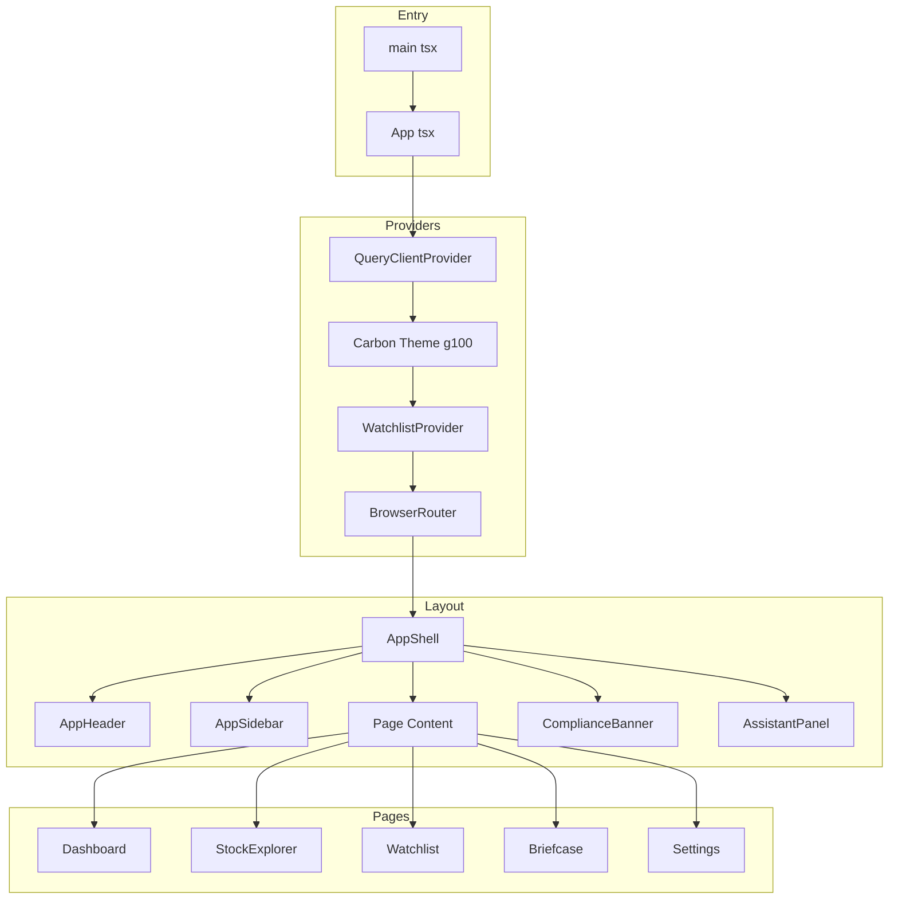
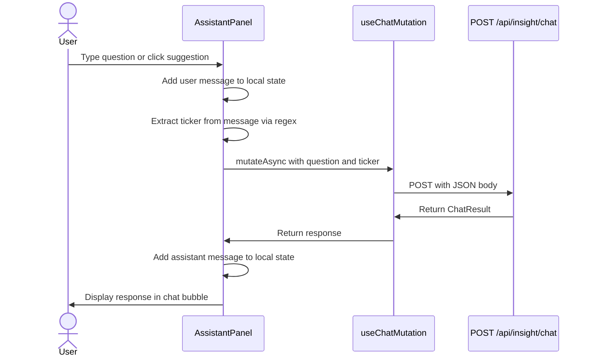
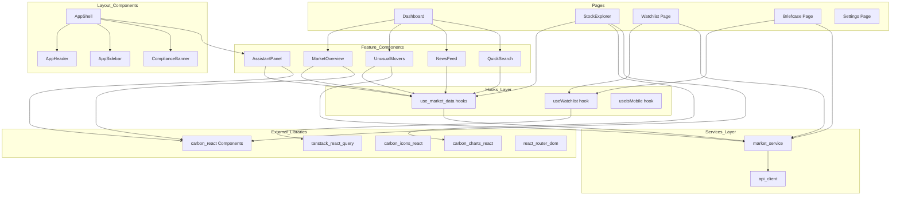

# Frontend Architecture and Functional Guide

**Project:** Insight Weaver (The Idea Factory)
**Version:** 1.0
**Date:** 2026-02-15

---

## 1. Overview

The frontend is a React 18 single-page application built with TypeScript, Vite, and the IBM Carbon Design System. It serves as the primary interface for the Retail Trader persona, providing market data visualization, AI-generated stock analysis, and a conversational AI assistant.

### Technology Stack

| Technology | Purpose |
|---|---|
| React 18 | UI framework |
| TypeScript | Type-safe development |
| Vite | Build tool and dev server with HMR |
| IBM Carbon (`@carbon/react`) | Enterprise UI component library |
| IBM Carbon Charts (`@carbon/charts-react`) | Financial data visualization |
| IBM Carbon Icons (`@carbon/icons-react`) | Iconography |
| IBM Plex (`@ibm/plex`) | Typography (Sans for text, Mono for financial data) |
| TanStack React Query | Server state management with caching |
| React Router v6 | Client-side routing |
| Tailwind CSS | Layout utilities and spacing |
| Sass | Carbon component styling |

---

## 2. Application Structure



---

## 3. Routing

| Path | Page | Description |
|---|---|---|
| / | Dashboard | Market overview, unusual movers, news feed |
| /explorer | StockExplorer | Stock detail view (defaults to RELIANCE) |
| /explorer/:ticker | StockExplorer | Stock detail for a specific ticker |
| /watchlist | Watchlist | User-managed stock groups |
| /briefcase | Briefcase | AI briefcase for watchlist stocks |
| /settings | Settings | Configuration and compliance info |
| * | NotFound | 404 error page |

All routes except NotFound are rendered within the `AppShell` layout, which provides the header, sidebar, compliance banner, and AI assistant panel.

---

## 4. Page Descriptions

### 4.1 Dashboard

**Purpose:** The landing page providing a "What Changed Today?" market snapshot.

**Functional Components:**

| Component | Data Source | Refresh Rate | Description |
|---|---|---|---|
| MarketOverview | GET /api/market/indices | 60 seconds | Displays NIFTY 50, SENSEX, NIFTY BANK, NIFTY IT as tiles with sector performance tags |
| UnusualMovers | GET /api/market/movers | 60 seconds | Table of stocks with abnormal price/volume. Each row has a "Get AI analysis" button that calls the explain endpoint |
| NewsFeed | GET /api/market/news | 120 seconds | List of market news with sentiment badges (positive/neutral/negative) |
| QuickSearch | GET /api/market/search?q= | On keystroke | Type-ahead search that navigates to the Stock Explorer on selection |

**User Flow:**
1. User sees market indices at a glance (positive changes in green, negative in red)
2. Sector performance tags show which sectors are up or down
3. The Unusual Movers table highlights stocks that need attention
4. Clicking "Get AI analysis" on a mover triggers the AI to explain the movement
5. Clicking any stock row navigates to the Stock Explorer for that ticker
6. The QuickSearch allows direct navigation to any stock

### 4.2 Stock Explorer

**Purpose:** Deep-dive view for a single stock with four tabs: Overview, News, Financials, and AI Brief.

**Data Source:** `GET /api/market/stock/{ticker}`

**Tab Breakdown:**

| Tab | Content | Description |
|---|---|---|
| Overview | Metric tiles + price chart | P/E, Market Cap, 52W High/Low, Volume. Carbon LineChart for 12-month price history |
| News | News list | Ticker-specific news with sentiment tags |
| Financials | Earnings table | Quarterly Revenue, PAT, EPS Growth, Margin in a data table |
| AI Brief | Peter Lynch-style analysis | 4-section AI-generated brief (Story, Numbers, Moat, Risks) |

**AI Brief Tab Flow:**
1. Initially shows placeholder sections with "Click to generate" messaging
2. User clicks "Generate AI Brief" button
3. The application calls `POST /api/insight/brief` with the ticker
4. While loading, each section shows contextual loading text ("Generating AI brief...", "Analyzing financial data...")
5. On completion, the response content is parsed into four sections using regex matching against section headers
6. Each section is displayed in a structured grid layout
7. Generation timestamp, sources, and disclaimer are shown at the bottom

### 4.3 Watchlist

**Purpose:** User-organized stock groups with live pricing data.

**State Management:** Uses the `WatchlistContext` (React Context) with in-memory state.

**Default Groups:**
- "Core Holdings" -- RELIANCE, HDFCBANK, INFY
- "Tracking" -- ADANIENT, TATAMOTORS

**Features:**
- **Two View Modes:** Table view and Card view, toggled via Carbon ContentSwitcher
- **Live Prices:** Stock details are fetched for all tickers in the watchlist using parallel API calls
- **Remove Stocks:** Each stock has a delete button to remove it from its group
- **Add Groups:** Users can create new watchlist groups via a text input
- **Navigation:** Clicking a stock navigates to the Stock Explorer

### 4.4 AI Briefcase

**Purpose:** A consolidated view of AI-ready briefs for all watchlist stocks.

**Business Logic:**
1. Reads all tickers from the Watchlist context
2. Fetches stock details for each ticker in parallel
3. Displays stocks as clickable cards with price change indicators
4. Each card shows a placeholder for the AI brief
5. Clicking a card navigates to the Stock Explorer where the brief can be generated

### 4.5 Settings

**Purpose:** Static informational page about the platform, compliance configuration, and responsible AI principles.

**Content Sections:**
- **Appearance** -- Theme toggle guidance
- **About Idea Factory** -- Platform description and pilot status
- **Compliance and Disclaimer** -- SEBI compliance rules: no trading recommendations, AI content labelling, data boundaries, Phase 1 scope
- **Responsible AI Principles** -- AI-generated labelling, audit trails, risk disclosures, no prescriptive calls, alignment with Microsoft Responsible AI guidelines

---

## 5. Layout Components

### 5.1 AppShell

The root layout component that orchestrates the page structure:

- **Theme Toggle:** Switches between Carbon `g100` (dark) and `white` (light) themes
- **Side Navigation:** Collapsible IBM Carbon `SideNav` with 5 navigation items
- **Header:** Carbon `Header` with app name, pilot badge, theme toggle, and AI assistant toggle
- **Compliance Banner:** Fixed footer with SEBI disclaimer visible on every page
- **AI Assistant Panel:** Slide-out chat panel from the right side

**State Management:**
```
isDark: boolean         -- Controls Carbon Theme (g100/white)
assistantOpen: boolean  -- Controls AI AssistantPanel visibility
sideNavExpanded: boolean -- Controls SideNav expansion
```

### 5.2 AppHeader

Uses Carbon `Header` component with:
- Hamburger menu to toggle side navigation
- App name "Idea Factory"
- Global actions: theme toggle (sun/moon icons), AI assistant toggle (chat icon)

### 5.3 AppSidebar

Uses Carbon `SideNav` component with five navigation items:
- Dashboard (DashboardIcon)
- Stock Explorer (Search icon)
- Watchlist (Bookmark icon)
- AI Briefcase (Portfolio icon)
- Settings (Settings icon)

Active state detection: exact match for "/" (Dashboard), prefix match for other routes.

### 5.4 ComplianceBanner

A fixed-position footer bar displaying the SEBI compliance disclaimer. Adjusts left margin based on SideNav expansion state.

---

## 6. AI Assistant Panel

The AI Assistant is a slide-out chat panel accessible from any page.

**Features:**
- Real-time conversation with the AI about Indian equities
- Suggested prompts for new users: "Explain today's move for RELIANCE", "Summarize latest earnings for TCS", etc.
- Automatic ticker detection from user messages using regex matching for uppercase words
- "Not Financial Advice" tag visible in the panel header

**Data Flow:**



**Error Handling:** If the API call fails, the panel displays a generic error message as an assistant response without crashing the application.

---

## 7. Data Fetching Strategy

### 7.1 React Query Configuration

All API interactions use React Query hooks defined in `hooks/use-market-data.ts`:

| Hook | Endpoint | Trigger | Stale Time | Refresh |
|---|---|---|---|---|
| useMarketOverview | GET /api/market/indices | Automatic | 30s | 60s interval |
| useUnusualMovers | GET /api/market/movers | Automatic | 30s | 60s interval |
| useStockDetail | GET /api/market/stock/{ticker} | When ticker provided | 30s | None |
| useNewsFeed | GET /api/market/news | Automatic | 60s | 120s interval |
| useSearchStocks | GET /api/market/search?q= | When query length > 0 | 60s | None |
| useInsightBrief | POST /api/insight/brief | Manual (enabled=false) | 15 min | None |
| useTodayView | POST /api/insight/today | Manual (enabled=false) | 15 min | None |
| useExplainMovement | POST /api/insight/explain | Manual (enabled=false) | 15 min | None |
| useChatMutation | POST /api/insight/chat | On user submit | N/A | N/A |

**Key Design Points:**
- Market data hooks auto-refresh to keep the dashboard current
- AI insight hooks are manually triggered (enabled=false) to avoid unnecessary AI calls
- AI responses have a 15-minute stale time matching the server-side Redis TTL
- The chat endpoint uses a mutation because each message is unique

### 7.2 API Client

The API client (`services/api-client.ts`) provides a typed HTTP client:

- **Base URL:** Configurable via `VITE_API_BASE_URL` environment variable (empty string uses same origin with Vite proxy)
- **Error Handling:** Non-2xx responses throw an `ApiError` with status, statusText, and parsed body
- **Content Type:** All requests include `Content-Type: application/json`

### 7.3 Vite Proxy Configuration

In development, Vite proxies API requests to the backend:

| Frontend Path | Backend Target |
|---|---|
| /api/* | Aspire API URL (via `services__api__https__0` env var) or http://localhost:5074 |
| /copilot/* | Same as above |

This eliminates CORS issues during development and simulates the production deployment where both are served from the same origin.

---

## 8. Client-Side State Management

### 8.1 Watchlist Context

The Watchlist is managed via React Context with the following operations:

| Operation | Description |
|---|---|
| addToGroup(ticker, groupName) | Adds a stock ticker to a named group |
| removeFromGroup(ticker, groupName) | Removes a stock from a group |
| addGroup(name) | Creates a new empty watchlist group |
| allTickers | Derived list of all unique tickers across groups |

State is held in memory (not persisted). Default groups are initialized on mount.

### 8.2 Theme State

Managed in the AppShell component. Toggling updates:
- Carbon `Theme` component prop (g100 or white)
- Document class list (adds/removes "dark" class for Tailwind dark mode)

---

## 9. Styling Architecture

The application uses a hybrid styling approach:

| Layer | Technology | Purpose |
|---|---|---|
| Component Styles | IBM Carbon Sass | Carbon component appearance via `@use '@carbon/react'` |
| Chart Styles | Carbon Charts CSS | Chart-specific styling via `@use '@carbon/charts-react/styles.css'` |
| Design Tokens | CSS Custom Properties | Colors, spacing, border radius defined in `:root` and `.dark` |
| Layout Utilities | Tailwind CSS | Flexbox, grid, spacing, responsive breakpoints |
| Typography | IBM Plex | Sans for body text, Mono for financial data (`.font-mono-data` utility) |
| Carbon Overrides | Custom CSS | Dark mode overrides for Carbon header, side nav, and data tables |

**Color System:**

Financial data uses semantic colors from Carbon design tokens:
- `text-carbon-success` (green) -- Positive changes
- `text-carbon-danger` (red) -- Negative changes
- `text-carbon-warning` (amber) -- Alerts, high volume ratios
- `text-carbon-info` (blue) -- Interactive elements

---

## 10. Frontend Component Dependency Graph



---

## 11. Testing Strategy

### 11.1 Frontend Tests

| Test Type | Framework | Location | Description |
|---|---|---|---|
| Unit Tests | Vitest | `*.test.ts` colocated with source | Hook and service logic |
| Component Tests | Vitest + Testing Library | `*.test.tsx` colocated | React component rendering and interaction |
| Setup | jsdom | `src/test/setup.ts` | JSDOM environment with Testing Library matchers |

### 11.2 Test Configuration

- **Environment:** jsdom (browser simulation)
- **Globals:** Enabled (describe, it, expect available without imports)
- **Path Aliases:** `@/` mapped to `src/` for consistent imports
