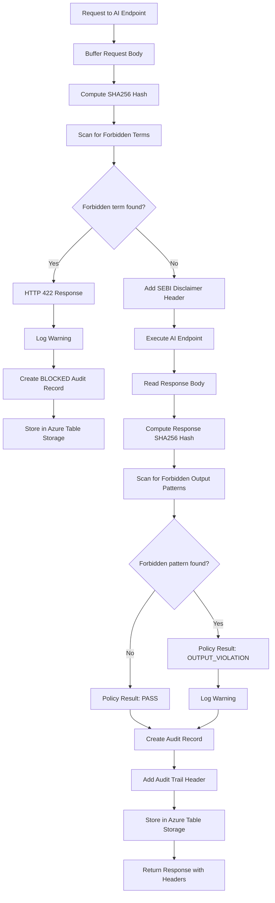
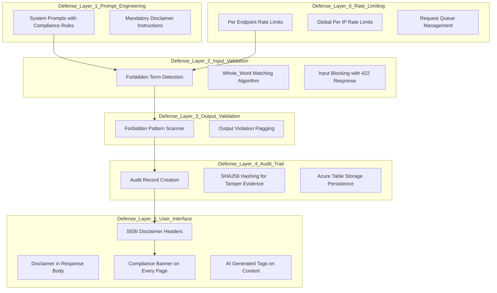

# Compliance and Governance Guide

**Project:** Insight Weaver (The Idea Factory)
**Version:** 1.0
**Date:** 2026-02-15

---

## 1. Overview

This document describes the compliance and governance framework built into the Idea Factory platform. The system is designed as an **Information Tool**, not an Advisory Engine, and implements multiple layers of safeguards to ensure alignment with SEBI (Securities and Exchange Board of India) regulations.

The core principle: **Governance precedes features.** The Prudence compliance layer was implemented before any AI endpoint was built.

---

## 2. SEBI Regulatory Context

### 2.1 Why This Matters

Under SEBI regulations, any platform that generates explicit trading recommendations (buy, sell, hold, target price) must be registered as an Investment Advisor. The Idea Factory is designed to operate **below this threshold** by:

- Providing factual, publicly-available information only
- Never generating prescriptive investment advice
- Clearly labelling all AI-generated content
- Maintaining a tamper-evident audit trail

### 2.2 Regulatory Boundaries

| Permitted | Prohibited |
|---|---|
| Factual stock data (price, volume, market cap) | Buy/sell/hold recommendations |
| AI-generated analysis of company fundamentals | Target prices or stop losses |
| Explanation of unusual market movements | Phrases like "you should invest" or "I recommend" |
| Historical earnings and financial metrics | Guaranteed returns or "sure shot" claims |
| News aggregation with sentiment tags | Personalized portfolio advice |

---

## 3. Prudence Middleware: The Compliance Engine

The Prudence middleware is the central compliance enforcement mechanism. It operates as an ASP.NET Core middleware in the HTTP pipeline, intercepting all requests to AI-related endpoints.

### 3.1 Monitored Paths

The middleware monitors requests to these path prefixes:
- `/api/insight` -- All AI insight endpoints
- `/api/chat` -- Conversational AI endpoint
- `/copilot` -- VS Code Copilot Extension

Requests to `/api/market` and `/api/governance` pass through without compliance checks (they serve factual data, not AI-generated content).

### 3.2 Input Validation

When a request arrives at a monitored path, the middleware:

1. **Buffers the request body** for inspection (enables re-reading by downstream handlers)
2. **Computes a SHA256 hash** of the request body for audit identification
3. **Scans for forbidden terms** using whole-word matching

**Forbidden Input Terms:**

| Category | Terms |
|---|---|
| Direct Action | buy, sell, hold |
| Rating Language | strong buy, strong sell, outperform, underperform, overweight, underweight |
| Target Specification | target price, price target, stop loss |
| Promotional Claims | guaranteed return, sure shot, multibagger, wealth creator |
| Advisory Verbs | subscribe, accumulate |

**Whole-Word Matching:** The system uses a word-boundary algorithm that checks characters before and after each match. This prevents false positives -- for example, "household" does not trigger "hold", and "buying" in the middle of a compound word is correctly handled.

**If a forbidden term is detected:**
- The request is immediately blocked with HTTP 422
- A compliance violation message is returned explaining why
- A BLOCKED audit record is created
- The request never reaches the AI model

### 3.3 Output Validation

After the AI model generates a response, the middleware inspects the output for forbidden patterns:

| Forbidden Phrase | Risk |
|---|---|
| "you should buy" / "you should sell" | Direct recommendation |
| "i recommend" / "we recommend" / "my recommendation" | Advisory language |
| "invest in" | Investment suggestion |
| "guaranteed" | Misleading claim |
| "risk-free" | Misleading claim |
| "sure profit" | Misleading claim |

**If a forbidden pattern is found in the output:**
- The response is still delivered to the user (the AI already generated it)
- The audit record is marked as OUTPUT_VIOLATION
- A warning is logged for review
- The compliance team can investigate via the Governance Report

### 3.4 Compliance Response Flow

---

## 4. Audit Trail Design

### 4.1 What Is Recorded

Every AI-related request generates a `ComplianceAudit` record with:

| Field | Description | Purpose |
|---|---|---|
| PartitionKey | Date (yyyy-MM-dd) | Enables efficient date-range queries |
| RowKey | Timestamp + GUID | Unique identifier within a partition |
| RequestPath | URI path (e.g., /api/insight/brief) | Which endpoint was called |
| RequestMethod | HTTP method (POST) | Request type |
| PromptHash | SHA256 of request body | Tamper-evident prompt identification |
| ResponseHash | SHA256 of response body | Tamper-evident response identification |
| PolicyResult | PASS, BLOCKED, or OUTPUT_VIOLATION | Compliance outcome |
| ViolationDetails | The specific term or pattern that triggered | For investigation |
| UserAgent | Client identifier | Track request sources |
| ResponseStatusCode | HTTP status returned | Verify endpoint behavior |
| DurationMs | Processing time in milliseconds | Performance monitoring |

### 4.2 Storage Architecture

- **Storage:** Azure Table Storage (Azurite emulator in development)
- **Table Name:** ComplianceAudit
- **Partitioning:** By date -- each day's records are in the same partition for efficient querying
- **Immutability:** Records are append-only; no update or delete operations are performed

### 4.3 Privacy Considerations

- **No Raw Prompts Stored:** Only SHA256 hashes of prompts and responses are recorded, not the actual content. This provides a tamper-evident trail without storing potentially sensitive user queries
- **User Agent Only:** The audit tracks the client user agent, not authenticated user identity (the pilot does not require authentication)

---

## 5. SEBI Compliance Headers

Every response from a monitored endpoint includes two custom headers:

| Header | Value | Purpose |
|---|---|---|
| X-SEBI-Disclaimer | "Not investment advice. For informational purposes only." | Machine-readable compliance tag |
| X-Compliance-Audit | {partitionKey}/{rowKey} | Reference to the specific audit record |

These headers provide:
- Programmatic verification that compliance processing occurred
- A direct link to the audit record for any response

---

## 6. AI Prompt Engineering for Compliance

### 6.1 System Prompts

Every AI model call includes a system prompt with compliance rules embedded. These rules are enforced at the prompt level (in addition to the middleware validation):

**Common Rules Across All Insight Types:**
- NEVER provide buy, sell, or hold recommendations
- NEVER suggest target prices or stop losses
- NEVER use phrases like "you should invest" or "I recommend"
- Always state that content is for informational purposes only
- All monetary values must be in INR
- Reference NSE/BSE exchanges only
- End every response with the mandatory disclaimer

### 6.2 Mandatory Disclaimer

Every AI response is instructed to end with:

> "This is AI-generated analysis for informational purposes only. Not investment advice."

This disclaimer is enforced at three levels:
1. **System Prompt** -- The AI is instructed to include it
2. **Response DTO** -- A `StandardDisclaimer` constant is included in the response body
3. **UI Display** -- The frontend renders the disclaimer with a warning icon

---

## 7. Rate Limiting for Abuse Prevention

### 7.1 Configuration

| Policy | Applies To | Limit | Window | Queue |
|---|---|---|---|---|
| AI Endpoint | /api/insight/*, /copilot/* | 10 requests | 1 minute | 5 queued |
| Default | All other endpoints | 60 requests | 1 minute | 10 queued |
| Global | Per IP address | 120 requests | 1 minute | N/A |

### 7.2 Behavior When Exceeded

- HTTP 429 (Too Many Requests) response
- JSON body with `retryAfter` duration
- Queued requests are processed in oldest-first order

---

## 8. Governance Reporting

### 8.1 Report Endpoint

`GET /api/governance/report?days=7` provides an aggregated compliance summary:

- **Total Requests** -- How many AI requests were processed
- **Passed Requests** -- Requests that cleared both input and output validation
- **Blocked Requests** -- Requests rejected due to forbidden input terms
- **Output Violations** -- Requests where the AI response contained forbidden patterns
- **Recent Violations** -- The 20 most recent non-passing audit records with details

### 8.2 Raw Audit Access

`GET /api/governance/audits?days=1` provides raw audit records for detailed forensic investigation. Each record includes the full compliance audit data including hashes and durations.

---

## 9. Responsible AI Principles

The platform aligns with the following responsible AI principles:

| Principle | Implementation |
|---|---|
| Transparency | Every AI-generated section is labelled with "AI-Generated - Not Financial Advice" |
| Accountability | Full audit trail with tamper-evident hashes for every AI interaction |
| Fairness | Same compliance rules apply to all users and all access paths (web UI and Copilot Extension) |
| Reliability | System prompts enforce consistent, factual output; output validation catches deviations |
| Explainability | AI responses explain reasoning and distinguish facts from speculation |
| Safety | Multi-layer compliance: system prompts, input validation, output validation, mandatory disclaimers |

---

## 10. Compliance Architecture Summary

This six-layer defense-in-depth approach ensures compliance is enforced at every level of the system, from the AI model's instructions to the user interface.
