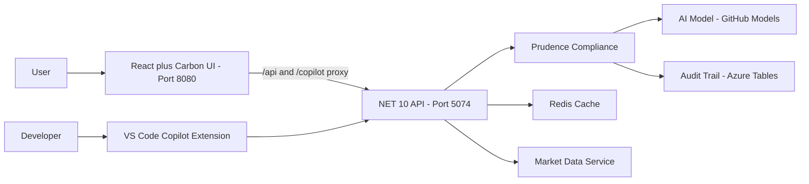

# Reference Documentation Index

**Project:** Insight Weaver (The Idea Factory)
**Version:** 1.0
**Date:** 2026-02-15
**Architect:** Raj Champaneriya

---

## About This Documentation

This reference documentation set provides comprehensive technical and functional documentation for the Idea Factory platform -- an AI-powered insight tool for Indian equities (NSE/BSE). The documentation is designed for both technical contributors and non-technical stakeholders.

---

## Document Catalog

| # | Document | Audience | Description |
|---|---|---|---|
| 01 | [High-Level Design (HLD)](01-high-level-design.md) | All stakeholders | System overview, logical architecture, technology stack, data flow, and non-functional requirements |
| 02 | [Low-Level Design (LLD)](02-low-level-design.md) | Developers, Architects | Detailed class design, service layer internals, middleware pipeline, data models, endpoint specifications |
| 03 | [Architecture Decision Records (ADR)](03-architecture-decision-records.md) | Architects, Tech Leads | 11 key architectural decisions with context, rationale, and consequences |
| 04 | [Architecture Diagrams](04-architecture-diagrams.md) | All stakeholders | Mermaid diagrams: C4 context/container, logical, functional, operational, deployment, data flow, component hierarchy, state management |
| 05 | [API Reference](05-api-reference.md) | Developers, QA | Complete API documentation with endpoints, request/response schemas, business logic, and error codes |
| 06 | [Frontend Architecture](06-frontend-architecture.md) | Frontend Developers | React component structure, routing, data fetching strategy, state management, styling architecture |
| 07 | [Compliance and Governance Guide](07-compliance-governance.md) | Compliance, Legal, All | SEBI compliance rules, Prudence middleware behavior, audit trail design, responsible AI principles |

---

## Quick Start for Contributors

### Running the Full Stack

```bash
dotnet run --project api/src/IdeaFactory.AppHost
```

This single command launches:
- The .NET 10 API on port 5074
- A Redis container for response caching
- An Azurite container for Azure Table Storage emulation
- The Vite development server on port 8080
- The Aspire developer dashboard with telemetry

### Key Directories

| Directory | Contents |
|---|---|
| `api/src/IdeaFactory.Api/` | Backend API -- endpoints, middleware, services, models |
| `api/src/IdeaFactory.AppHost/` | Aspire orchestrator -- resource wiring |
| `api/src/IdeaFactory.ServiceDefaults/` | Shared Aspire defaults -- telemetry, health checks |
| `api/tests/IdeaFactory.Api.Tests/` | Backend integration tests |
| `ui/src/` | React frontend source code |
| `ui/src/pages/` | Page-level components |
| `ui/src/components/` | Reusable UI components |
| `ui/src/services/` | API client and service functions |
| `ui/src/hooks/` | React Query hooks for data fetching |
| `reference-docs/` | This documentation set |
| `plan/` | PRD, technical specification, implementation plan |

### Architecture at a Glance



---

## Personas and Interfaces

| Persona | Interface | Primary Use Case |
|---|---|---|
| Retail Trader | React Web Application | "What changed today?" -- market overview, stock research, AI-generated briefs |
| Technical Validator | VS Code Copilot Extension | Validate AI architecture by querying stocks from IDE: "@idea-factory brief on RELIANCE" |

---

## Key Business Rules

1. **No Investment Advice** -- The system never generates buy/sell/hold recommendations
2. **SEBI Compliance** -- All AI responses include mandatory disclaimers
3. **Indian Market Only** -- NSE/BSE tickers, INR currency, Indian market context
4. **Audit Everything** -- Every AI interaction is logged with prompt/response hashes
5. **Inform, Not Advise** -- AI prompts are engineered to present facts, not make recommendations

---

## Diagram Legend

All diagrams in this documentation set use Mermaid.js format and can be rendered in:
- GitHub markdown preview
- VS Code with the Mermaid extension
- Any Mermaid-compatible documentation platform

Diagram types used:
- **graph TD/LR** -- Architectural and component diagrams
- **sequenceDiagram** -- Request/response flows
- **flowchart** -- Decision trees and process flows
- **classDiagram** -- Service and model structures
