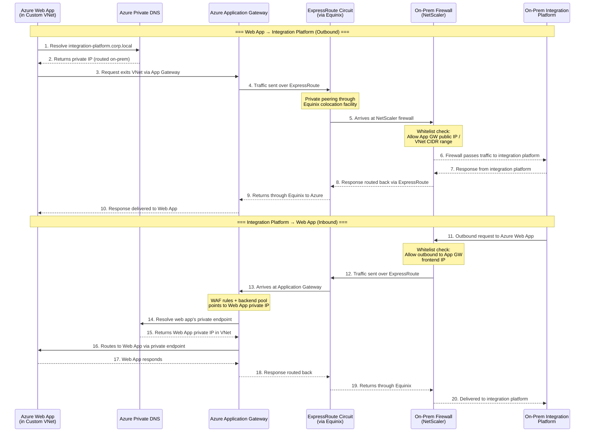

# Azure Web App to On-Premises Integration Platform — Network Connectivity

## Sequence Diagram

## The Components

| Component | What it does |
|---|---|
| **Custom VNet for App Service** | A private network bubble in Azure. Your Web App lives here with a **private IP**, so it is not exposed to the public internet. Think of it as the Web App's gated neighborhood. |
| **Azure Private DNS** | The internal phonebook. When any component inside Azure asks "where is X?", Private DNS translates the friendly name into a private IP address -- no public DNS involved. |
| **Azure Application Gateway** | The front door and security guard. It sits at the edge of your VNet, terminates TLS, runs WAF (Web Application Firewall) rules, and decides which backend (your Web App) gets the traffic. It is the only thing with a known, stable IP that both sides whitelist. |
| **ExpressRoute (via Equinix)** | A dedicated, private cable between Azure and your data center. Traffic never touches the public internet. **Equinix** is the physical colocation facility where your network and Microsoft's network meet and plug into each other. |
| **NetScaler (On-Prem Firewall)** | Your on-premises gatekeeper. Every packet entering or leaving your data center passes through it. It enforces whitelist rules -- only traffic from approved IPs/ranges gets through. |
| **Integration Platform** | The on-prem system your Web App needs to talk to (and vice versa). |

## How Whitelisting Works (Both Directions)

### Web App to Integration Platform (outbound from Azure)

1. The Web App's outbound traffic exits through the **Application Gateway**, which has a known, stable outbound IP (or the VNet's NAT Gateway IP).
2. On the **NetScaler firewall**, you create an inbound rule: "Allow traffic from Azure App Gateway IP / VNet CIDR range on port 443 (or whatever port the integration platform listens on)."
3. Traffic that does not match this whitelist is dropped.

### Integration Platform to Web App (inbound to Azure)

1. The NetScaler has an outbound rule: "Allow traffic to the Application Gateway's frontend public IP on port 443."
2. The **Application Gateway** has its own rules: a backend pool pointing to the Web App's private IP inside the VNet, plus WAF rules to block malicious requests.
3. The App Gateway uses **Private DNS** to resolve the Web App's private endpoint hostname to its VNet-internal IP.
4. Optionally, the Web App's **access restrictions** are set to only accept traffic from the Application Gateway's subnet -- so even within Azure, nothing else can reach it directly.

## Why Each Piece Is Necessary

- **Without the Custom VNet** -- the Web App would be publicly accessible; anyone could hit it.
- **Without Private DNS** -- Azure components could not resolve internal names and would try public DNS, breaking private routing.
- **Without Application Gateway** -- there is no central, auditable entry/exit point with WAF protection and a stable IP to whitelist.
- **Without ExpressRoute/Equinix** -- traffic would go over the public internet, adding latency and security risk.
- **Without NetScaler whitelisting** -- any source could send traffic into your on-prem network.

The net result: traffic flows through a fully private, whitelisted path with no public internet exposure at any hop.
